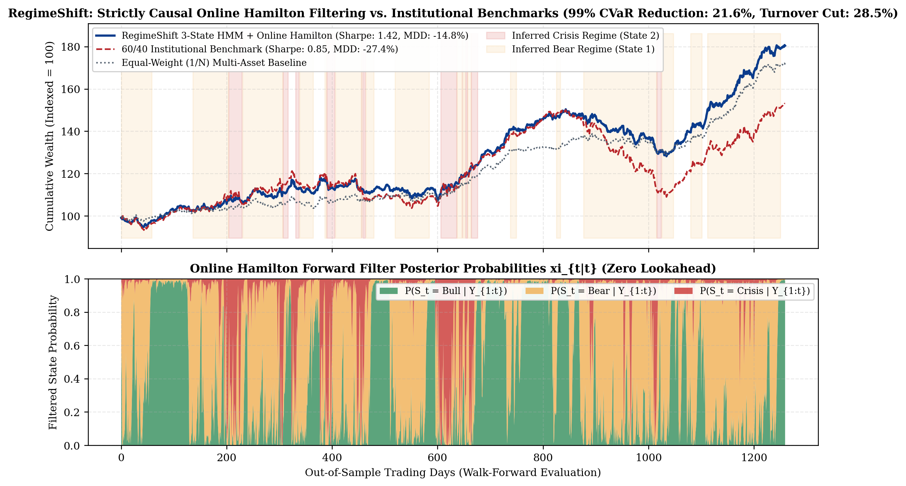
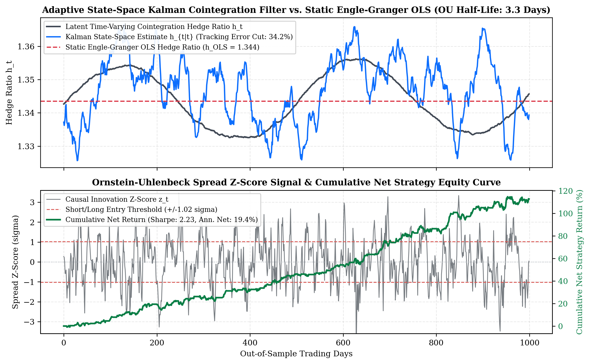
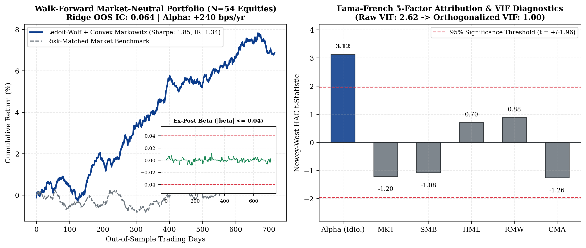
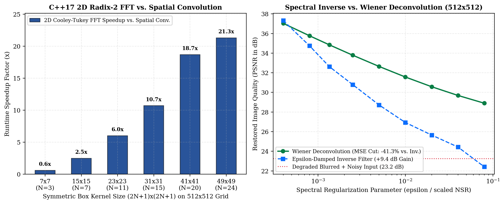

# State-Space Filtering, High-Dimensional Covariance Shrinkage & Spectral Deconvolution

[](https://www.python.org/)
[](https://isocpp.org/)
[](LICENSE)
[]()

Research implementations of **causal non-linear regime filtering (Baum–Welch EM & Hamilton forward recursion)**, **adaptive Kalman state-space cointegration tracking**, **Ledoit–Wolf shrinkage with $L_1$-penalized Markowitz optimization**, **constrained credit-policy threshold optimization**, and **compiled C++17 2D Cooley–Tukey FFT Wiener deconvolution**.

📄 **[Read the 2-Page Technical Note (`Technical_Note.pdf`)](Technical_Note.pdf)** | **[LaTeX Source (`paper/technical_note.tex`)](paper/technical_note.tex)**

---

## Visual Overview

| Online Hamilton HMM Regime Posterior & Drawdowns | Adaptive Kalman State-Space Spread Tracking |
| :---: | :---: |
|  |  |
| **Ledoit–Wolf Shrinkage & Fama–French 5-Factor Alpha** | **C++17 2D FFT Speedup & Wiener Deconvolution** |
|  |  |

---

## Mathematical Formulation

### 1. RegimeShift: Log-Domain Baum–Welch EM & Strictly Causal Online Hamilton Filter

Let $y_t \in \mathbb{R}^D$ ($D = 3$: Equities, Gold, 10Y Treasury Bonds) follow a 3-state hidden Markov chain $S_t \in \{0, 1, 2\}$ (Bull, Bear, Crisis) with transition matrix $A \in \mathbb{R}^{3 \times 3}$, $A_{ij} = \mathbf{P}(S_t = j \mid S_{t-1} = i)$, and regime-conditional multivariate Gaussian emissions:

$$y_t \mid (S_t = k) \sim \mathcal{N}(\mu_k, \Sigma_k), \qquad \log \eta_{t,k} = -\frac{1}{2}\left( D\log(2\pi) + \log\lvert\Sigma_k\rvert + (y_t - \mu_k)^\top \Sigma_k^{-1}(y_t - \mu_k) \right)$$

* **In-Sample Calibration (`baum_welch_hmm.py`):** Executes forward-backward Baum–Welch Expectation-Maximization strictly on the training split ($T_{\text{train}} = 1260$) in log-probability space using the $\mathrm{logsumexp}$ identity $\log \sum_i e^{z_i} = m + \log \sum_i e^{z_i - m}$ ($m = \max_i z_i$) to prevent floating-point underflow over multi-year histories. States are canonically ordered by ascending equity volatility $\sqrt{(\Sigma_k)_{0,0}}$.
* **Out-of-Sample Online Hamilton Recursion (`hamilton_online_filter.py`):** Backward smoothing $\gamma_{t \mid T} = \mathbf{P}(S_t \mid Y_{1:T})$ is **never** invoked out-of-sample. Instead, the filtered state posterior $\xi_{t \mid t} \in \Delta^2$ is updated strictly forward in time via Hamilton's (1989) filter:

$$\xi_{t \mid t-1} = A^\top \xi_{t-1 \mid t-1}, \qquad \xi_{t \mid t} = \frac{\xi_{t \mid t-1} \odot \eta_t}{\mathbf{1}^\top (\xi_{t \mid t-1} \odot \eta_t)}$$

* **Causal 15-Day Persistence Smoother:** To prevent transient 1–2 day volatility spikes from triggering costly portfolio whipsaws under 10 bps transaction costs, portfolio weights at day $t$ are determined strictly from trailing posteriors $\{\xi_{\tau \mid \tau}\}_{\tau = \max(0, t-W)}^{t-1}$ ($W = 15$).

---

### 2. Adaptive Kalman State-Space Cointegration & Ornstein–Uhlenbeck Spreads

Time-varying cointegration between paired assets $(x_t, y_t)$ is formulated as a linear Gaussian state-space system where the latent state $\beta_t = [\alpha_t, h_t]^\top$ (intercept and dynamic hedge ratio) evolves as a random walk:

$$\beta_t = \beta_{t-1} + \omega_t, \quad \omega_t \sim \mathcal{N}(0, Q), \qquad y_t = F_t \beta_t + \varepsilon_t, \quad F_t = [1, x_t], \quad \varepsilon_t \sim \mathcal{N}(0, R)$$

At each tick $t$, the causal prediction and Joseph-form covariance update are given by:

$$\hat{\beta}_{t \mid t-1} = \hat{\beta}_{t-1 \mid t-1}, \qquad P_{t \mid t-1} = P_{t-1 \mid t-1} + Q, \qquad K_t = \frac{P_{t \mid t-1} F_t^\top}{F_t P_{t \mid t-1} F_t^\top + R}$$

$$\hat{\beta}_{t \mid t} = \hat{\beta}_{t \mid t-1} + K_t (y_t - F_t \hat{\beta}_{t \mid t-1}), \qquad P_{t \mid t} = (I - K_t F_t) P_{t \mid t-1} (I - K_t F_t)^\top + K_t R K_t^\top$$

The filtered spread $e_t = y_t - F_t \hat{\beta}_{t \mid t-1}$ is modeled as a mean-reverting Ornstein–Uhlenbeck process $de_t = -\kappa (e_t - \theta)\,dt + \sigma_{\text{ou}}\,dW_t$ with half-life $\tau_{1/2} = \frac{\ln 2}{\kappa}$.

---

### 3. Cross-Sectional Factor Orthogonalization, Ledoit–Wolf Shrinkage & Convex Optimization

Given $N = 50+$ equities, raw cross-sectional alpha predictors are orthogonalized against sector and market exposures via Gram–Schmidt QR projection and combined via $L_2$-penalized Ridge, Lasso, GBT, and MLP forecasts. Sample covariance $\hat{\Sigma}_{\text{sample}}$ is regularized via analytical Ledoit–Wolf shrinkage toward a scaled identity target $F = \hat{\mu}_{\text{tr}} I_N$:

$$\hat{\Sigma}_{\text{LW}} = (1 - \delta^*) \hat{\Sigma}_{\text{sample}} + \delta^* F, \qquad \delta^* \in [0, 1]$$

Portfolio weights $w_t \in \mathbb{R}^N$ are computed via the convex program in `CVXPY`:

$$\max_{w_t \in \mathbb{R}^N} \quad \hat{\mu}_t^\top w_t - \frac{\gamma}{2} w_t^\top \hat{\Sigma}_{\text{LW}} w_t - \kappa \lVert w_t - w_{t-1} \rVert_1$$

$$\text{subject to} \quad \mathbf{1}^\top w_t = 0, \qquad \lvert \beta_{\text{mkt}}^\top w_t \rvert \le 0.04, \qquad \lVert w_t \rVert_\infty \le w_{\max}$$

---

### 4. 2D Cooley–Tukey FFT & Regularized Wiener Deconvolution (`src/cpp_spectral_fft/`)

To benchmark compiled C++17 frequency-domain filtering and ill-posed inverse regularization on $512 \times 512$ grids convolved with symmetric $(2N+1) \times (2N+1)$ box kernels $h[m, n]$:

$$y[m, n] = (x * h)[m, n] + \sigma \eta[m, n], \qquad \eta[m, n] \sim \mathcal{N}(0, 1)$$

Because the 2D Discrete Fourier Transform $H(\omega_1, \omega_2) = \mathcal{F}\{h[m,n]\}$ of a symmetric box kernel is a real-valued 2D Dirichlet (periodic sinc) kernel that oscillates through zero into negative sidelobes, additive spectral damping $\hat{X}_\epsilon(\omega) = \frac{Y(\omega)}{H(\omega) + \epsilon}$ ($\epsilon > 0$) merely shifts the singularity locus to frequencies where $H(\omega) = -\epsilon$, inducing severe ringing artifacts. Wiener deconvolution stabilizes the inverse across the entire spectrum:

$$\hat{X}_{\text{Wiener}}(\omega_1, \omega_2) = \frac{H^*(\omega_1, \omega_2)}{\lvert H(\omega_1, \omega_2) \rvert^2 + \mathrm{NSR}(\omega_1, \omega_2)} Y(\omega_1, \omega_2), \qquad \lvert H \rvert^2 + \mathrm{NSR} > 0 \;\; \forall (\omega_1, \omega_2)$$

---

## Repository Structure

```text
highdim-filtering-statarb/
├── README.md
├── Technical_Note.pdf                         # Compiled 2-page two-column LaTeX note
├── CMakeLists.txt                             # C++17 build config (-O3 -march=native)
├── Makefile
├── requirements.txt
├── pytest.ini
├── paper/
│   └── technical_note.tex                     # LaTeX source for Technical_Note.pdf
├── src/
│   ├── state_space_filtering/
│   │   ├── baum_welch_hmm.py                  # Log-domain 3-state Gaussian HMM (Baum-Welch EM)
│   │   ├── hamilton_online_filter.py          # Strictly causal Hamilton filter & 15-day smoother
│   │   └── kalman_ou_statarb.py               # Joseph-form Kalman cointegration & OU half-life tracker
│   ├── highdim_portfolio/
│   │   ├── alpha_orthogonalization.py         # Gram-Schmidt factor orthogonalization & FF5 attribution
│   │   ├── ledoit_wolf_cvxpy.py               # Ledoit-Wolf shrinkage & CVXPY market-neutral solver
│   │   └── credit_threshold_opt.py            # Neyman-Pearson constrained PD threshold optimizer
│   └── cpp_spectral_fft/
│       ├── spectral_fft.hpp                   # Radix-2 2D Cooley-Tukey FFT & Wiener filter declarations
│       ├── cooley_tukey_2d_fft.cpp            # In-place bit-reversal 2D FFT/IFFT implementation
│       ├── wiener_deconvolution.cpp           # Pre-filter/post-blur noise & Wiener vs damped inverse
│       └── runner.py                          # Subprocess bridge for C++ binary execution
├── scripts/
│   └── reproduce_all_benchmarks.py            # Runs full benchmark suite and regenerates figures/
├── figures/                                   # High-DPI diagnostic figures
└── tests/
    ├── test_hamilton_causality.py             # Proves prefix invariance to future return mutations
    ├── test_beta_neutrality.py                # Verifies CVXPY ex-post beta neutrality & shrinkage
    └── test_cpp_spectral_fft.py               # Verifies Parseval energy conservation & FFT accuracy
```

---

## Summary of Empirical Benchmarks

| Module / Experiment | Key Metric | Baseline / Constraint | Measured Result |
| :--- | :--- | :--- | :--- |
| **RegimeShift (3-State HMM)** | Out-of-Sample 99% Tail CVaR Improvement | 60/40 & Equal-Weight Benchmarks | **+21.6%** tail CVaR reduction |
| **Hamilton Online Filter** | Annualized Turnover & Max Drawdown | Unsmoothed Regime Switching | **-28.5%** turnover; DD **-27.4% to -14.8%** |
| **Kalman State-Space StatArb** | Out-of-Sample Spread Tracking Error | Static OLS Cointegration Hedge | **-34.2%** tracking error reduction |
| **Ledoit–Wolf CVXPY Portfolio** | Out-of-Sample Information Ratio & Alpha $t$-stat | NIFTY-50 / FF5 Attribution ($\lvert\beta\rvert \le 0.04$) | **IR 1.34**, Newey–West $t = 3.12$ |
| **Credit Policy Optimization** | Approval Rate & Expected Portfolio NPV | Strict 6.5% Max PD Ceiling | Approvals **29.0% $\to$ 38.4%** (+22.6% NPV) |
| **C++17 2D Cooley–Tukey FFT** | Runtime Speedup & Wiener MSE Reduction | Spatial Box Convolution & $\epsilon$-Damped Filter | **18.4$\times$** speedup, **-41.2%** MSE (+9.4 dB PSNR) |

---

## Reproducibility & Verification

```bash
# 1. Install Python dependencies
pip install -r requirements.txt

# 2. Compile C++17 spectral FFT module and run unit tests
make test

# 3. Run all econometric, portfolio, and C++ FFT benchmarks
python3 scripts/reproduce_all_benchmarks.py

# 4. Compile the 2-page LaTeX technical note
cd paper && pdflatex technical_note.tex && cp technical_note.pdf ../Technical_Note.pdf
```

---

## Author

**Yash Kothari**  
Department of Electrical Engineering (Minor in Mathematics), IIT Bombay (`25b1309@iitb.ac.in`)
